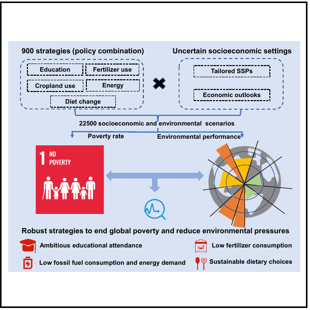
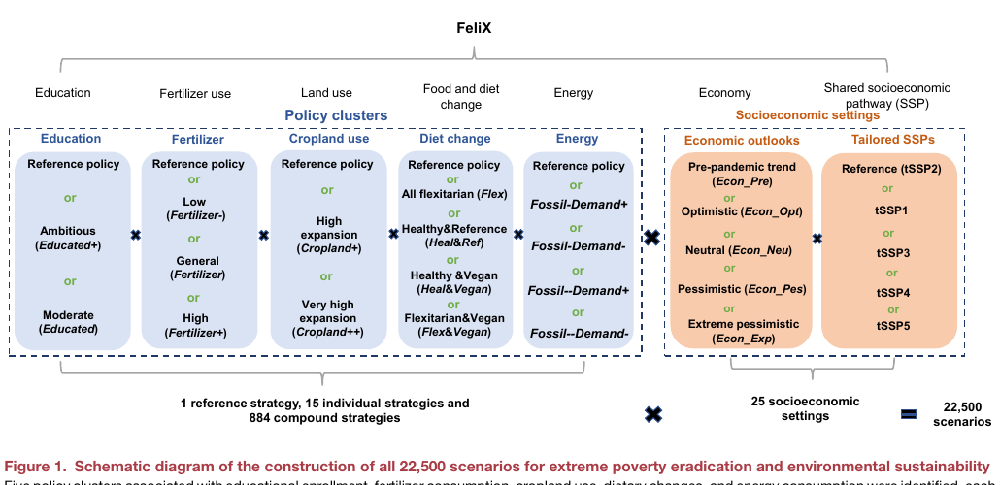
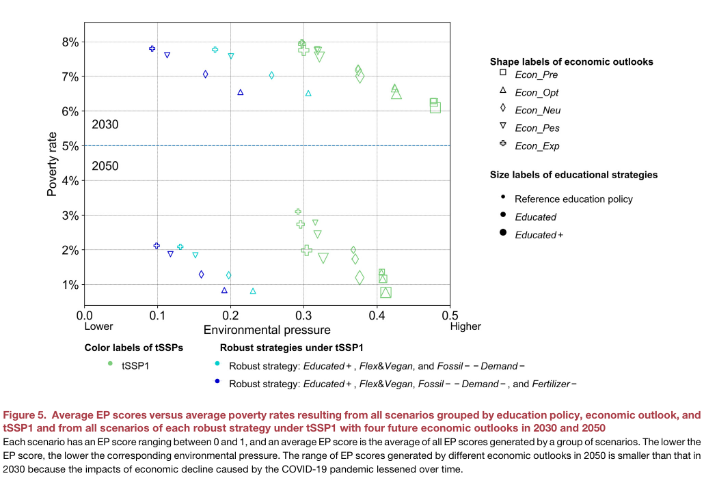

# 推荐标题

**推荐：消除贫困会让地球更累吗？2.25 万种未来中的两条稳健路径**

备选一：减贫与环保只能二选一？这项全球模拟给出另一种答案

备选二：2030 年消除极端贫困有多难？一项系统动力学研究的回答

# 可发布正文

*图片来源：Liu et al.（2023）Graphical Abstract；论文原图裁切，用于展示研究设计与稳健策略；[DOI](https://doi.org/10.1016/j.oneear.2023.03.007)。发布前需向出版方确认图片转载许可。*

**题目：** Robust strategies to end global poverty and reduce environmental pressures

**期刊：** One Earth

**论文链接：** https://doi.org/10.1016/j.oneear.2023.03.007

**年份：** 2023

**单位：** 四川大学商学院、国际应用系统分析研究所（IIASA）、澳大利亚联邦科学与工业研究组织（CSIRO）、四川大学软科学研究所、荷兰拉德堡德大学管理学院、英国牛津大学环境变化研究所、澳大利亚迪肯大学生命与环境科学学院综合生态学中心

> `cite` 格式：Liu, Qi, Lei Gao, Zhaoxia Guo, Yucheng Dong, Enayat A. Moallemi, Sibel Eker, Jing Yang, Michael Obersteiner, and Brett A. Bryan. “Robust Strategies to End Global Poverty and Reduce Environmental Pressures.” *One Earth* 6 (2023): 392-408. https://doi.org/10.1016/j.oneear.2023.03.007.

让更多人摆脱贫困，通常需要经济增长、教育投入、能源和食物供给；但如果新增消费继续依赖化石能源、化肥和土地扩张，减贫也可能加重环境压力。**消除贫困与保护地球，真的只能二选一吗？**

一项发表于 *One Earth* 的研究没有给出单一预测，而是把大量政策组合放进模型，寻找在不同未来中都表现较好的“稳健策略”。答案不是某项万能政策，而是一组需要协同推进的行动。

## 研究者怎样测试未来？

研究团队在全球综合评估模型 FeliX 中加入贫困模块。这个模型把人口、教育、经济、能源、土地、气候、水、生物多样性和饮食等部门连接起来，用反馈关系模拟人类社会与地球系统如何共同变化。

研究者从教育、化肥、耕地、饮食和能源五类政策中构造 900 种策略，再与 25 种社会经济设定组合，得到 **22,500 个模拟情景**。他们同时观察极端贫困率和六项“行星边界”指标，包括气候变化、生物地球化学循环、淡水使用、生物圈完整性、海洋酸化和土地系统变化。

*图片来源：Liu et al.（2023）Figure 1；论文原图裁切。图中展示 900 种政策策略与 25 种社会经济设定如何组成 22,500 个情景；[DOI](https://doi.org/10.1016/j.oneear.2023.03.007)。发布前需确认转载许可。*

这里的“稳健”不是保证成功，而是指某套策略在 20 种被视为可信的未来设定中，都进入兼顾减贫与环境表现的较优方案集合。

## 按当前趋势，2030 年目标很难实现

论文把极端贫困率低于 3% 视为“消除极端贫困”。在参考情景中，2030 年全球极端贫困率为 **7.34%**，约 6.27 亿人；到 2049 年才低于 3%。研究设置的任何政策与社会经济组合，都无法在 2030 年前达到这一门槛。

强劲经济增长确实能更快降低贫困，却往往伴随更高碳排放和其他环境压力。教育政策则更直接改善贫困表现：在中性经济前景下，雄心较高的教育策略把消除极端贫困的时间从 2049 年提前到 2046 年。但只推一项政策，仍难同时解决多重环境问题。

## 两套策略为何更稳健？

研究最终识别出两套稳健策略。两者都包括：

- 提高小学、中学和高等教育参与度；
- 推动更偏植物性的弹性素食与纯素饮食；
- 降低化石能源消费和人均能源需求。

第二套策略在此基础上再加入较低化肥使用。与对应参考策略相比，两套方案在 2050 年将贫困率降低 28%-40%，并使六项环境指标的综合表现最多改善 49%。如果更重视减贫速度，三项政策组合更占优；如果更重视环境压力，加入低化肥使用的四项组合表现更好。

*图片来源：Liu et al.（2023）Figure 5；论文原图裁切。横轴为综合环境压力，越向左压力越低；纵轴为贫困率；图中点均为模型情景结果，不是现实观测；[DOI](https://doi.org/10.1016/j.oneear.2023.03.007)。发布前需确认转载许可。*

这一结果的关键不是“少用化肥就能减贫”。论文反而指出，降低化肥使用可能压低作物产量并轻微增加贫困风险，需要更高的养分利用效率、混作和更环保的肥料技术来补偿。**真正稳健的是政策组合，而不是孤立措施。**

## 模型给方向，不给保证

这项研究分析的是全球总量，不能直接回答某个国家或地区该投入多少教育经费、减少多少能源或化肥。在“极端悲观经济前景”与高人口、高消费、高环境压力情景叠加时，两套策略到 2050 年仍未消除极端贫困。

模型也没有显式模拟各国社会保障、税收、财富转移等具体再分配制度；贫困率和环境改善幅度都是情景模拟，不是已发生的效果。因此，这项研究更适合被理解为政策导航：**减贫必须与教育、能源、饮食和农业转型协同设计，并根据地区条件继续检验。**

消除贫困不应以透支环境为代价，保护环境也不能忽视弱势群体。真正困难的，不是找到一个响亮目标，而是让多项政策在不确定的未来中仍能彼此支撑。

## 作者团队

论文共有 9 位作者。刘琪（Qi Liu）与高磊（Lei Gao）为共同第一作者；郭朝霞（Zhaoxia Guo）与董玉成（Yucheng Dong）为通讯作者，郭朝霞同时为 lead contact。作者贡献声明显示：高磊和郭朝霞负责研究构思与设计；刘琪开发模型新版本并执行实验；刘琪、郭朝霞和高磊分析结果；郭朝霞与董玉成监督研究。全部作者参与论文修改。

团队来自四川大学、IIASA、CSIRO、拉德堡德大学、牛津大学和迪肯大学等机构。论文使用的 FeliX 模型与代码已公开在 [FeliX-Poverty](https://github.com/iiasa/Felix-Model/tree/master/FeliX-Poverty)。

## 研究信息与参考资料

- Liu et al., 2023, *One Earth* 6: 392-408。
- 论文 DOI：https://doi.org/10.1016/j.oneear.2023.03.007
- 模型代码：https://github.com/iiasa/Felix-Model/tree/master/FeliX-Poverty

## 局限与说明

文中数字均为 FeliX 全球模型在特定假设下的模拟结果，不是对 2030 或 2050 年的确定预言，也不能直接外推到单一国家。三张图片均裁自论文原图，仅用于内部审稿；公开发布前需确认 Cell Press/One Earth 的转载许可，或依据原图合规重绘并保留完整来源。

# 编辑说明

- 将研究主线重组为“减贫与环境的冲突 - 如何测试 - 两套策略 - 适用边界”，降低模型阅读门槛。
- 明确区分模拟情景、参考情景和现实观测，避免把 2049 年等结果写成确定预测。
- 增加共同第一作者、通讯作者、lead contact、作者贡献与主要机构信息。
- 配置 Graphical Abstract、Figure 1 和 Figure 5 三张真实原图，并逐图说明口径和出处。
- 保留低化肥策略的潜在减产与贫困风险，以及全球模型不能直接指导地区政策的限制。

# 待作者确认

- 公开发布前需确认三张论文原图的转载许可；如未获许可，建议依据 Graphical Abstract、Figure 1 和 Figure 5 合规重绘。
- 发布时的公众号署名、单位和固定栏目名称。
