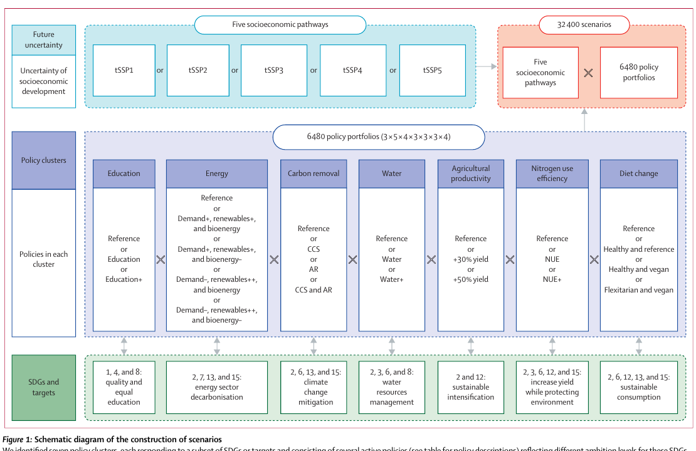
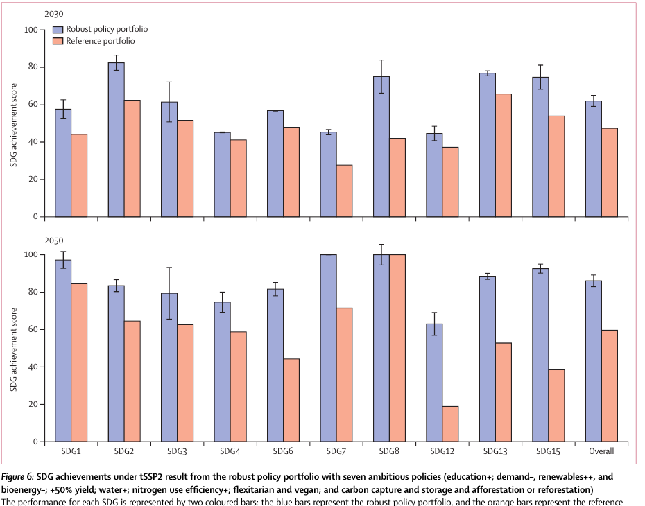

# 推荐标题

**推荐：可持续发展不能“单科突击”：3.24 万种未来筛出的政策组合**

备选一：17 项全球目标为何需要“组合拳”？一项系统模型研究的答案

备选二：教育、能源、农业与饮食一起改变，能让 SDG 进度快多少？

# 可发布正文

*图片来源：Yang et al.（2025）Figure 1；论文原图裁切，展示政策组合与情景构建；CC BY-NC-ND 4.0；[DOI](https://doi.org/10.1016/j.lanplh.2025.101318)。*

**题目：** Integrative Sustainable Development Goal policy portfolios to accelerate global progress towards a more sustainable future: a modelling study

**期刊：** The Lancet Planetary Health

**论文链接：** https://doi.org/10.1016/j.lanplh.2025.101318

**年份：** 2025

**单位：** 四川大学华西公共卫生学院、国际应用系统分析研究所（IIASA）、澳大利亚联邦科学与工业研究组织（CSIRO）、四川大学商学院、湘江实验室、湖南工商大学数字媒体工程与人文学院、山东交通学院信息科学与电气工程学院、山东师范大学商学院、牛津大学环境变化研究所、迪肯大学生命与环境科学学院

> `cite` 格式：Yang, Jing, Lei Gao, Zhaoxia Guo, Yucheng Dong, Enayat A. Moallemi, Sibel Eker, Qi Liu, Zengxiao Chi, Fengming Liu, Michael Obersteiner, and Brett A. Bryan. “Integrative Sustainable Development Goal Policy Portfolios to Accelerate Global Progress towards a More Sustainable Future: A Modelling Study.” *The Lancet Planetary Health* 9 (2025): 101318. https://doi.org/10.1016/j.lanplh.2025.101318.

减贫、教育、清洁能源、气候行动、生物多样性……17 项可持续发展目标像一张相互牵连的网。只盯住其中一项，可能拉动其他目标，也可能带来新问题：发展生物能源会不会挤占土地？扩大造林会不会争夺水和耕地？

一项发表于 *The Lancet Planetary Health* 的模型研究提出，全球可持续转型不能靠“单科突击”，而需要跨教育、能源、农业、水和饮食等部门共同设计政策组合。

## 3.24 万种未来，怎样算出来？

研究团队使用全球系统动力学模型 FeliX。模型连接人口、教育、经济、贫困、能源、土地、水、食物、化肥、气候、碳循环和生物多样性等 12 个模块，并用 1950-2021 年的历史资料进行校准。

研究者从七类政策中各选一项，形成 **6480 个政策组合**：教育、能源、碳移除、水资源、农业生产率、氮利用效率和饮食改变。再把每个组合放入五条不同的社会经济路径，最终得到 **32,400 个模拟情景**，观察到 2050 年的变化。

他们用 32 个指标衡量 10 项 SDG，包括消除贫困与饥饿、健康、教育、清洁水与能源、经济增长、负责任消费、气候行动和陆地生物。这些指标被转成 0-100 分，并等权计算总分。因此，文中的“完成度”是研究设定下的模型评分，**不是联合国发布的官方进度，也不是对未来的确定预言。**

## 单项政策有用，但不够用

在延续当前趋势的中间路径中，参考政策组合到 2030 年的十项目标总体得分约为 47，2050 年约为 60。模型显示，减贫、教育和经济目标随时间改善，但清洁水、负责任消费、气候和生物多样性等环境目标可能恶化。

任何单项政策到 2050 年都能让总分比参考组合提高，但增幅只有 0.7%-5.9%。原因在于一项政策常常同时带来协同与权衡。例如，提高教育参与度有助于减贫、健康和清洁能源，却也可能通过收入和食物需求增长，增加化肥使用；造林有利于气候和生物多样性，却可能占用耕地和淡水。

这正是“组合拳”的价值：不是假装没有冲突，而是用其他政策缓冲冲突。

## 两套七政策组合表现最稳健

研究从不同整合程度中识别出 25 套稳健组合。其中，两套包含七项积极政策的组合在多数目标上表现最好：

- 提高各级教育参与度；
- 降低能源需求、加快可再生能源替代；
- 同时采用碳捕集与封存和造林；
- 提高作物产量；
- 加强节水、废水回用和需求管理；
- 提高农业氮利用效率；
- 转向更健康、更偏植物性的饮食。

两套方案的差别，是是否限制生物能源生产。不限生物能源的方案在 2030 年对“繁荣”相关目标更有利；限制生物能源的方案到 2050 年对生态系统、食物等目标更友好，长期综合表现更稳健。相对没有新增行动的参考组合，七政策组合到 2030 年可使总体进度最多提高约 11%，到 2050 年最多提高 **19.6%-29.5%**。

*图片来源：Yang et al.（2025）Figure 6；论文原图裁切。蓝色为限制生物能源生产的七政策稳健组合，橙色为参考组合；误差线表示五条社会经济路径下的变化范围；均为模型情景结果；CC BY-NC-ND 4.0；[DOI](https://doi.org/10.1016/j.lanplh.2025.101318)。*

## 钱和能力有限，先做什么？

论文没有要求所有国家立刻同时启动七项高强度政策。若资源有限，模型给出的 2030 年优先项是：**快速推动能源系统脱碳并降低能源需求，同时提高农业氮利用效率。**这两项出现在不同整合程度下的六套优选组合中。

从更长时间看，健康可持续饮食带来的跨目标收益更突出，其后仍是能源转型和氮效率。但实施时必须管理生物能源作物扩张、造林与耕地、水资源之间的竞争。

## 模型给方向，落地仍要因地制宜

FeliX 是全球汇总模型，无法直接给出某个国家的预算、技术路线或政策强度。研究只覆盖 17 项 SDG 中的 10 项、19 个目标和 32 个指标，并简化了新冠疫情、俄乌战争等重大事件，也未纳入社会保障和转移支付等政策。

因此，这项研究最重要的启示不是“照抄七项清单”，而是：**制定一项政策时，要同时追问它会怎样影响其他目标；面对更困难的未来，更需要跨部门协同，而不是各自为战。**

## 作者团队

论文共有 11 位作者。杨静（Jing Yang）与高磊（Lei Gao）为共同第一作者；郭朝霞（Zhaoxia Guo）和董玉成（Yucheng Dong）为通讯作者。贡献声明显示：高磊和郭朝霞负责研究构思与设计；杨静校准模型、开发情景并执行实验；杨静、郭朝霞和高磊分析结果；郭朝霞与董玉成监督研究。杨静和郭朝霞直接核验论文底层数据，全部作者均可访问数据并对投稿决定负责。

团队来自四川大学、IIASA、CSIRO、湘江实验室、湖南工商大学、山东交通学院、山东师范大学、牛津大学和迪肯大学等机构。论文所用模型与代码已在 [FeliX-SDGsAssessment](https://github.com/iiasa/Felix-Model/tree/master/Previous_and_Branched_Versions/2023_FeliX_SDGsAssessment) 公开。

## 研究信息与参考资料

- Yang et al., 2025, *The Lancet Planetary Health* 9: 101318。
- 论文 DOI：https://doi.org/10.1016/j.lanplh.2025.101318
- 模型代码：https://github.com/iiasa/Felix-Model/tree/master/Previous_and_Branched_Versions/2023_FeliX_SDGsAssessment

## 局限与说明

文中所有进度分数和政策效果均为 FeliX 全球模型在特定指标、权重与情景假设下的模拟结果，不能视为官方 SDG 评估或国家级政策预测。两张配图均为论文原图裁切，依照 CC BY-NC-ND 4.0 仅作不改动的非商业传播，并保留完整署名、许可与来源；正式发布时仍应遵守公众号用途及出版方要求。

# 编辑说明

- 将论文重组为“为什么需要组合政策—如何评估—组合优于单项—短长期优先级—适用边界”的公众号叙事。
- 明确解释总体 SDG 分数的 32 指标、十项目标和等权口径，避免误写成联合国官方完成度。
- 使用真实 Figure 1 和 Figure 6，并核对坐标、图例、情景及 CC BY-NC-ND 4.0 许可。
- 补充共同第一作者、通讯作者、作者贡献、主要单位和开源代码。
- 保留生物能源、造林、粮食和水资源之间的权衡，以及全球模型无法直接指导单一国家的限制。

# 待作者确认

- 发布时的公众号署名、单位和固定栏目名称。
- 公众号文章如包含商业推广、付费阅读或广告，应先确认是否符合 CC BY-NC-ND 4.0 的“非商业”要求。
