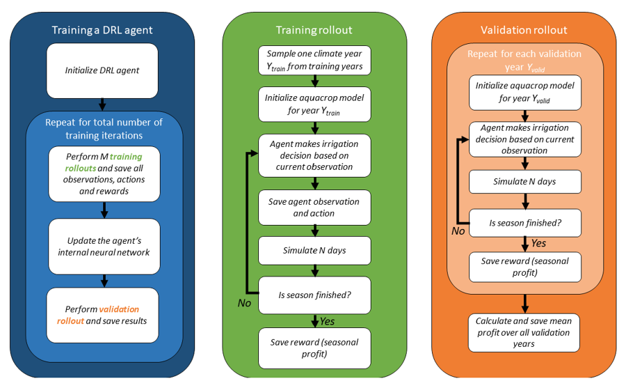
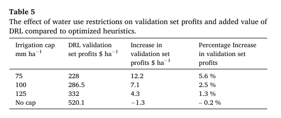

# 推荐标题

**推荐：AI管灌溉，真的比简单规则更聪明吗？**

备选一：水越紧张，深度强化学习越会浇水？

备选二：让AI决定玉米何时浇水，一项模拟研究发现了什么

# 可发布正文

*图片来源：Kelly et al.（2024），Figure 2；论文原图，CC BY 4.0；[DOI](https://doi.org/10.1016/j.atech.2024.100403)*

**题目：** Assessing the value of deep reinforcement learning for irrigation scheduling

**期刊：** Smart Agricultural Technology

**论文链接：** https://doi.org/10.1016/j.atech.2024.100403

**年份：** 2024

**单位：** 英国曼彻斯特大学工程学院（School of Engineering）、地球与环境科学系（Department of Earth and Environmental Sciences）、危机研究与减灾中心（Centre for Crisis Studies and Mitigation）

> `cite` 格式：Kelly, T. D., T. Foster, and David M. Schultz. 《Assessing the value of deep reinforcement learning for irrigation scheduling》. Smart Agricultural Technology 7 (2024): 100403. https://doi.org/10.1016/j.atech.2024.100403.

给庄稼浇水，看似只是“缺了就浇”，实际却是一场持续数月的权衡：今天多浇一点，可能提高产量，也可能增加成本；如果明天恰好下雨，水就可能白花。人工智能擅长复杂决策，它能比一套简单的灌溉规则做得更好吗？

这项研究给出的答案是：**不一定。只有在水特别紧张、环境相对可预测时，深度强化学习的优势才更明显。**

## AI怎样在“虚拟农田”里学会浇水？

深度强化学习可以理解为一名反复练习的灌溉管理员。它观察土壤湿度、近期天气、作物长势、生育阶段和剩余水量，再决定何时浇、浇多少。收获后，系统根据产量、粮价和灌溉成本计算利润，并据此调整下一轮策略。

开头的论文 Figure 2 展示了这一过程：AI先在训练年份中反复决策并更新神经网络，再到未参与训练的年份接受检验。检验阶段不再学习，因而更接近“面对未来天气”的场景。

研究以美国内布拉斯加州西南部的灌溉玉米为案例，将深度强化学习接入作物模型 AquaCrop-OSPy。研究者根据当地1982—2018年的气象观测生成100年合成天气，其中70年用于训练，30年用于验证。

## 正常降雨下，简单规则反而略胜

为了公平比较，研究者没有给AI安排一个很弱的对手，而是优化了一套常见的土壤湿度规则：玉米在不同生育阶段采用不同湿度阈值，土壤低于阈值才触发灌溉。

在降雨正常波动、灌溉用水不限量的情景中，表现最好的AI方案每3天决策一次，验证期平均利润为每公顷520.1美元；优化后的土壤湿度规则为521.4美元。AI低约0.2%，差距虽小，却说明：**模型更复杂，不等于面对陌生天气时收益更高。**

AI在训练数据上的表现更好，却没有把优势稳定带到验证年份，这与机器学习中的“过拟合”有关。论文所用计算机上，AI训练100万步约需4小时，优化四个土壤湿度阈值则约需20分钟。

## 水越紧张，AI越可能体现价值

研究者人为去掉全部降雨后，AI相对优化规则的验证期利润提高2.1%。这不是说现实中“无雨更好”，而是说明当难以预测的降雨干扰消失时，复杂策略更容易转化为稳定收益。

更明显的变化出现在限水情景。灌溉上限为125毫米时，AI的利润优势为1.3%；收紧到100毫米时为2.5%；只有75毫米时达到5.6%，约合每公顷多12.2美元。

*图片来源：Kelly et al.（2024），Table 5；论文原表，展示验证期不同灌溉上限下的利润及AI相对优化规则的增幅；[DOI](https://doi.org/10.1016/j.atech.2024.100403)*

水充足时，简单规则已经能处理大部分问题；水很少时，每次灌溉都意味着取舍，系统需要考虑作物阶段、当前缺水程度和余下配额。**约束越强，复杂决策方法才越可能体现价值。**

## 谁完成了这项研究？

论文共有三位作者，均来自英国曼彻斯特大学。第一作者 T.D. Kelly 参与研究构思、数据整理、正式分析、方法设计和软件开发；通讯作者 T. Foster 参与研究构思、方法与软件开发，并负责经费获取；David M. Schultz 参与经费获取、研究监督以及论文初稿和修改。上述分工来自论文的 CRediT 作者贡献声明。

团队同时公开了 [aquacrop-gym](https://github.com/aquacropos/aquacrop-gym)，供研究者训练灌溉智能体，并与其他灌溉策略比较。

## 先别急着把农田交给AI

这是一场严格的“虚拟考试”，不是现实部署证明。研究只涉及一个地区、一种作物和单一均质田块；天气由历史观测生成，作物生长与利润也来自模型计算。设备故障、传感器误差和田间土壤差异尚未真正进入考验。

因此，更务实的路线是：**先优化简单、透明的灌溉规则；当水量受到严格限制，或需要在多块田、多种作物和多年配额之间动态权衡时，再评估深度强化学习是否值得投入。**

真正重要的问题不是“能不能用AI”，而是“在哪些条件下，用AI比简单方法更划算”。如果水资源日益紧张，你会选择透明的固定规则，还是尝试AI决策？

## 参考资料

- Kelly, T. D., T. Foster, and David M. Schultz, 2024, *Smart Agricultural Technology*, 7: 100403。
- 论文 DOI：https://doi.org/10.1016/j.atech.2024.100403
- 开源代码：https://github.com/aquacropos/aquacrop-gym

## 局限与说明

文中收益、灌溉表现及两张配图均来自论文中的作物模型实验和合成天气情景，不能直接视为其他地区、作物或真实田间条件下的预期效果。

# 编辑说明

- 按新版 skill 在正文第一屏加入真实论文图片、题目、期刊、链接、年份、作者单位和完整引用。
- 头图直接采用论文 Figure 2，结果图直接采用 Table 5，并标注图表编号、用途、许可和 DOI。
- 补充三位作者、通讯作者身份及论文 CRediT 声明中的贡献分工，不推测个人履历。
- 保留正常降雨、无降雨和三档限水结果，同时明确区分训练、验证与真实田间效果。
- 将算法过程解释为“虚拟农田练习”，减少非专业读者的理解门槛。

# 待作者确认

- 发布时的公众号署名、单位和固定栏目名称。
